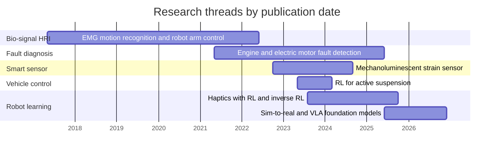

  

  
  

 

  

 

  <picture>
    <source media="(prefers-color-scheme: dark)" srcset="assets/kit_logo_dark.png" />
    
  </picture>

 

## 🧬 About

<table>
  <tr>
    <td width="160"><b>🧪 Position</b></td>
    <td>
      <b>Postdoctoral Researcher</b> · AX Research &amp; Innovation Center, AX Graduate School Project 
      Kumoh National Institute of Technology (KIT) · Research topic: <b>Sim-to-Real Robot Manipulation with VLA Models</b>
    </td>
  </tr>
  <tr>
    <td><b>🎓 Education</b></td>
    <td>
      <b>Ph.D.</b> in Mechanical Engineering, Kumoh National Institute of Technology (KIT) · 2026 
      <b>M.S.</b> in Mechanical Design Engineering, KIT · 2020 
      <b>B.S.</b> in Mechanical Design Engineering, KIT · 2018 
      Ph.D. advisor: Prof. Jung Woo Sohn · <a href="https://sites.google.com/view/kit-ssc">AI &amp; Autonomous System Lab. (AIAS Lab)</a>
    </td>
  </tr>
  <tr>
    <td><b>📄 Ph.D. Thesis</b></td>
    <td>
      <i>Sim-to-Real Transfer of Vision-Language-Action Foundation Models for Collaborative Robot Manipulation</i> 
      협동 로봇 조작을 위한 비전-언어-행동(VLA) 기반 모델의 시뮬레이션-실세계 전이
    </td>
  </tr>
  <tr>
    <td><b>📚 Publications</b></td>
    <td>
      5 international journal papers · 6 domestic journal papers · 35+ conference presentations
    </td>
  </tr>
  <tr>
    <td><b>💼 Experience</b></td>
    <td>
      Researcher (HPC system administration), Supercomputing Center, KIT · Jan – Aug 2026
    </td>
  </tr>
  <tr>
    <td><b>👨‍🏫 Teaching</b></td>
    <td>
      Lecturer, KIT · Capstone Design in Mechanical Engineering (2022)
    </td>
  </tr>
</table>

 

## 🧭 Research Journey

<table>
  <tr>
    <td width="200" align="center"><b>Sim-to-Real VLA</b> 2025 – now · Ph.D. thesis</td>
    <td>
      End-to-end pipeline that fine-tunes a Vision-Language-Action foundation model (GR00T N1.7) on simulation data and deploys it on a real UR5e.
      With <b>zero real demonstrations</b>, photorealistic video augmentation raised real-robot success from <b>6.25 % to 43.75 %</b>. 
      Isaac Sim / Isaac Lab · haptic teleoperation for demos · AprilTag hand-eye calibration · Cosmos Transfer augmentation ·
      failure-mode taxonomy (sim demos moved 4.3× more per step than real ones, the root of the table-crash failure)
    </td>
  </tr>
  <tr>
    <td align="center"><b><a href="https://github.com/ydg1021/haptic-irl-manipulation">Haptics + Inverse RL</a></b> 2024 – 2025 · peg-in-hole</td>
    <td>
      Haptic teleoperation with contact-force feedback to record insertion demonstrations in simulation.
      Adversarial inverse RL (AIRL) then learned the reward and the policy for peg-in-hole from those demonstrations. 
      MuJoCo · Isaac Lab · Doosan A0509 ·
      <a href="https://doi.org/10.1109/ictc66702.2025.11388681">ICTC 2025</a> · PRESM 2024
    </td>
  </tr>
  <tr>
    <td align="center"><b><a href="https://github.com/ydg1021/robot-hand-rl-simulink">Robot Hand Grasping RL</a></b> 2023 – 2024 · prosthetic hand</td>
    <td>
      A lab-built prosthetic-hand prototype is operated through a sensor glove, and five DDPG agents trained in Simulink drive the haptic-feedback servos on the glove. 
      <a href="https://doi.org/10.1117/12.3010674">SPIE Smart Structures + NDE 2024</a> ·
      <a href="https://doi.org/10.5050/ksnve.2023.33.4.372">Trans. KSNVE 2023</a> (haptic glove)
    </td>
  </tr>
  <tr>
    <td align="center"><b><a href="https://github.com/ydg1021/rl-active-suspension">RL Active Suspension</a></b> 2023 – 2024 · vehicle control</td>
    <td>
      Reinforcement-learning controller for a vehicle active suspension system. 
      <a href="https://doi.org/10.7736/jkspe.023.141">J. Korean Soc. Precis. Eng. 2024</a> · KSNVE 2023 · KSME 2023
    </td>
  </tr>
  <tr>
    <td align="center"><b><a href="https://github.com/ydg1021/mechanoluminescent-fiber-sensor">Mechanoluminescent Strain Sensor</a></b> 2022 – 2024 · smart sensor</td>
    <td>
      Fabricated a fiber-type flexible sensor from a mechanoluminescent material, which emits light under strain, and evaluated its mechanical and sensing characteristics. 
      <a href="https://doi.org/10.14775/ksmpe.2024.23.09.001">J. KSMPE 2024</a> · AMSM 2022 · PRESM 2023 · ML &amp; NSHD 2023
    </td>
  </tr>
  <tr>
    <td align="center"><b><a href="https://github.com/ydg1021/engine-motor-fault-diagnosis">Fault Diagnosis</a></b> 2021 – 2025 · engine, electric motor</td>
    <td>
      Deep-learning anomaly detection for vehicle engines from surrounding sensor data, and fault detection for electric motors from vibration signals with transfer learning and image-based classification. 
      <a href="https://doi.org/10.5050/ksnve.2022.32.5.488">Trans. KSNVE 2022</a> ·
      <b>Best Student Award (Silver), PHMAP 2021</b> · PHM Korea 2023 / 2025 ·
      <a href="https://doi.org/10.57062/ijpem-st.2024.00185">IJPEM-ST 2025</a> (review)
    </td>
  </tr>
  <tr>
    <td align="center"><b><a href="https://github.com/ydg1021/emg-motion-recognition-robot-arm">EMG Motion Recognition</a></b> 2017 – 2022 · M.S. thesis</td>
    <td>
      Hand and arm motion recognition from surface EMG and IMU signals, used to control and remotely manipulate a robot arm.
      Extended to user-independent recognition, with a sign-language translator and a rock-paper-scissors robot built along the way. 
      <a href="https://doi.org/10.1007/s12206-022-0507-x">J. Mech. Sci. Technol. 2022</a> ·
      <a href="https://doi.org/10.5050/ksnve.2018.28.6.670">Trans. KSNVE 2018</a> · PRESM 2018 / 2019 / 2020
    </td>
  </tr>
</table>

 

## 📝 Publications

**International journals**

- M. Kim, **D.-G. Yuk**, J. Lee, J. W. Sohn, "Sim-to-Real Transfer of Deep Reinforcement Learning for Robotic Pick-and-Place Tasks," *Int. J. Precis. Eng. Manuf.*, 2026. [doi](https://doi.org/10.1007/s12541-026-01595-5)
- O. Munyaneza, **D.-G. Yuk**, J. W. Sohn, "A State-of-art on Damage Detection of Composite Structure Using Lamb Wave and Deep Learning Techniques," *Int. J. Precis. Eng. Manuf.-Smart Technol.*, 3(1), 65–82, 2025. [doi](https://doi.org/10.57062/ijpem-st.2024.00185)
- J. W. Sohn, J. S. Ruth, **D.-G. Yuk**, S.-B. Choi, "Application of Shape Memory Alloy Actuators to Vibration and Motion Control of Structural Systems: A Review," *Applied Sciences*, 13(2), 995, 2023. [doi](https://doi.org/10.3390/app13020995)
- J. Shim et al. (incl. **D.-G. Yuk**), "A Surface Conformal Laser-Assisted Alloying Reaction for 3D-Printable Solid/Liquid Biphasic Conductors," *Small Science*, 3(3), 2200089, 2023. [doi](https://doi.org/10.1002/smsc.202200089)
- **D.-G. Yuk**, J. W. Sohn, "User Independent Hand Motion Recognition for Robot Arm Manipulation," *J. Mech. Sci. Technol.*, 36(6), 2739–2747, 2022. [doi](https://doi.org/10.1007/s12206-022-0507-x)

<b>Domestic journals (6)</b>

 

- M. Kim, **D.-G. Yuk**, D. Ryu, J. W. Sohn, "Mechanical Characteristics Evaluation of Fibrous Mechanoluminescent Sensor," *J. Korean Soc. Manuf. Process Eng.*, 23(9), 1–11, 2024. [doi](https://doi.org/10.14775/ksmpe.2024.23.09.001)
- **D.-G. Yuk**, J. W. Sohn, "Active Suspension Control Using Reinforcement Learning," *J. Korean Soc. Precis. Eng.*, 41(3), 223–230, 2024. [doi](https://doi.org/10.7736/jkspe.023.141)
- J. Y. Shim, **D.-G. Yuk**, J. W. Sohn, "Robot Hand Control Using Haptic Glove," *Trans. Korean Soc. Noise Vib. Eng.*, 33(4), 372–379, 2023. [doi](https://doi.org/10.5050/ksnve.2023.33.4.372)
- H.-J. Lee, **D.-G. Yuk**, J. W. Sohn, "Image Data-based Product Classification and Defect Detection," *Trans. Korean Soc. Noise Vib. Eng.*, 32(6), 601–607, 2022. [doi](https://doi.org/10.5050/ksnve.2022.32.6.601)
- **D.-G. Yuk**, J. W. Sohn, "Vehicle Engine Anomaly Detection Using Data from Surrounding Sensors," *Trans. Korean Soc. Noise Vib. Eng.*, 32(5), 488–494, 2022. [doi](https://doi.org/10.5050/ksnve.2022.32.5.488)
- **D.-G. Yuk**, J. W. Sohn, "Hand Gesture Recognition Using Surface Electromyogram," *Trans. Korean Soc. Noise Vib. Eng.*, 28(6), 670–676, 2018. [doi](https://doi.org/10.5050/ksnve.2018.28.6.670)

<b>International conferences (10)</b>

 

- **D.-G. Yuk**, J. W. Sohn, "Force-Aware Robotic Manipulation via Haptic-Guided Inverse Reinforcement Learning," ICTC 2025. [doi](https://doi.org/10.1109/ictc66702.2025.11388681)
- **D.-G. Yuk**, J. W. Sohn, "Haptic-guided Robot Arm Control Using Reinforcement Learning," PRESM 2024.
- **D.-G. Yuk**, J. W. Sohn, "Haptic-based Robot Hand Grasping Technique Using Reinforcement Learning," SPIE Smart Structures + NDE 2024. [doi](https://doi.org/10.1117/12.3010674)
- M. Kim, **D.-G. Yuk**, D. Ryu, J. W. Sohn, "Characteristics Evaluation of Fibrous Mechanoluminescent Sensor," ML &amp; NSHD 2023.
- M. Kim, **D.-G. Yuk**, D. Ryu, J. W. Sohn, "Performance Evaluation of Fibrous Sensor Based on Mechanoluminescent Material," PRESM 2023.
- **D.-G. Yuk**, D. Ryu, H. S. Kim, J. W. Sohn, "Fabrication of Fiber Type Mechanoluminescent Soft Sensor," AMSM 2022.
- **D.-G. Yuk**, D. Ryu, J. W. Sohn, "Classification of Normal/Abnormal Conditions for Vehicle Engine," PHMAP 2021. 🥈
- **D.-G. Yuk**, J. W. Sohn, "Remote Manipulation of Robot Arm Using EMG-Based Hand Motion Recognition," PRESM 2020.
- **D.-G. Yuk**, J. W. Sohn, "Robot Arm Manipulation Using Electromyogram Sensors and Inertia Measurement Unit," PRESM 2019.
- **D.-G. Yuk**, J. W. Sohn, "Hand Gesture Recognition Using Electromyogram Signals," PRESM 2018.

 

## 🏆 Awards

<table>
  <tr>
    <td width="70" align="center"><b>2021</b></td>
    <td>🥈 <b>Best Student Award, Silver Medal</b> — PHMAP 2021 (Asia Pacific Conference of the PHM Society) 차량 엔진 정상/비정상 상태 분류 연구</td>
  </tr>
  <tr>
    <td width="70" align="center"><b>2018</b></td>
    <td>🏅 <b>Outstanding Student Presentation</b> — KSNVE Spring Conference 2018 한국소음진동공학회 춘계학술대회 학생 우수 논문 발표 — 동작 인식을 이용한 로봇 제어</td>
  </tr>
</table>

 

## 🛠️ Tech Stack

  
  
  
  
  
  
  
  

  Hardware: UR5e · Robotiq 2F-85 · Force Dimension omega.6 · Intel RealSense D455 / D435i

 

## 🔍 Research Interests

  
  
  
  
  

 

